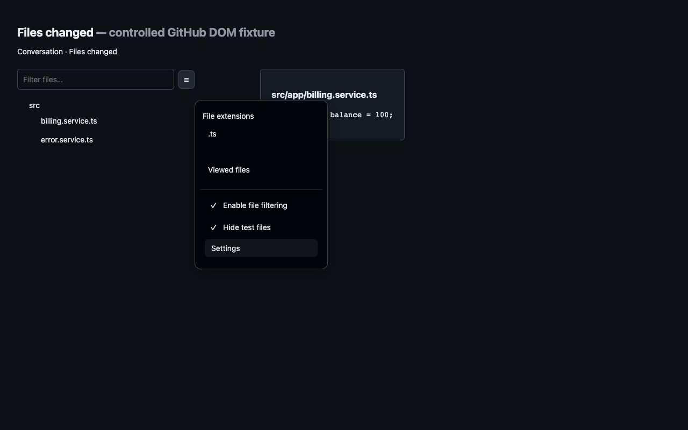

# GitHub PR File Filter

[Chrome Web Store](https://chromewebstore.google.com/detail/github-pr-file-filter/femlegodeikdcchheikbcdnpcckdpbic) · [Русская документация](docs/README.ru.md) · [Releases](https://github.com/vezmenov/github-pr-file-filter/releases) · [Report an issue](https://github.com/vezmenov/github-pr-file-filter/issues)

A browser extension that hides test files and selected file types from GitHub pull request reviews. It filters both the file tree and the complete diff cards, including collapsed cards and files loaded later.



The **Hide test files** switch is added to GitHub's file filter menu beside **Filter files…**. Settings let you choose language presets, exclude file extensions or path patterns, and keep exceptions visible. Turning filtering off restores the files. The extension does not change Viewed markers, comments, or review drafts.

## Install

1. Open [GitHub PR File Filter in the Chrome Web Store](https://chromewebstore.google.com/detail/github-pr-file-filter/femlegodeikdcchheikbcdnpcckdpbic).
2. Click **Add to Chrome** and confirm installation.
3. Reload your GitHub PR page, open the file filter menu beside **Filter files…**, and enable **Hide test files**.

Version **1.1.0** was confirmed publicly available in the store on October 18, 2026 (Europe/Moscow).

### Alternative: install an unpacked release

1. Download the latest `github-pr-file-filter-<version>.zip` from [GitHub Releases](https://github.com/vezmenov/github-pr-file-filter/releases) and extract it.
2. Open `chrome://extensions` in Chrome or `edge://extensions` in Edge.
3. Enable **Developer mode**, click **Load unpacked**, and select the extracted directory containing `manifest.json`. For a source checkout, select `extension/`.
4. Reload your GitHub PR page, open the file filter menu, and enable **Hide test files**.

To update an unpacked installation, replace its files, click **Reload** on its extension card, then reload the PR page. Chrome Web Store listing materials and the dated publication status are in [the publishing guide](docs/CHROME_WEB_STORE.md).

## Settings

Open the extension popup or GitHub's file filter menu and choose **Settings**. Settings are saved locally in this browser profile and update other open GitHub tabs. Automatic test hiding starts off.

| Setting | Effect |
| --- | --- |
| Enable filtering | Master switch. When off, all files hidden by this extension return. |
| Hide tests | Apply the selected automatic test presets. |
| File tree / Diff cards | Choose where filtering applies. |
| Test presets | Enable or disable individual groups of naming and directory conventions. |
| Hidden extensions | Hide suffixes such as `.snap`, `.map`, `.d.ts`, or `.min.js`. These rules also work when Hide tests is off. |
| Hidden path patterns | Hide files matching your own glob patterns. These rules also work when Hide tests is off. |
| Always show patterns | Keep matching files visible, even if a test preset or exclusion would hide them. |
| Case sensitivity | Choose whether path matching distinguishes upper- and lowercase letters. |
| Language | Follow the browser language, or use English or Russian. |

Enter one extension or pattern per line. Use the path preview to check a rule before saving. Export/import JSON transfers settings between profiles; it does not use cloud synchronization. Import and Reset update the unsaved form; click Save to apply them. The exported format is `{ "version": 1, "hideTests": false, "settings": { ... } }`; imported files are validated before applying them.

### Pattern examples

Patterns match repository-relative file paths. A pattern without `/` matches the basename at any depth. `*` matches within one path segment, `**` crosses directories, and `?` matches one character. `**/` also matches zero directories. Patterns match the whole path or basename, not an arbitrary substring.

| Pattern | Matches |
| --- | --- |
| `*.snap` | Snapshot files anywhere in the PR. |
| `**/*.generated.ts` | Generated TypeScript files at any depth. |
| `packages/legacy/**` | Everything under `packages/legacy/`. |
| `**/fixtures/**` | Files inside any `fixtures` directory. |
| `src/config?.json` | `src/config1.json`, `src/configA.json`, and similar names. |

For example, hide `.snap` and `.map` extensions plus `**/*.generated.ts`, then add `tests/README.md` to **Always show patterns** to retain that file. Always-show rules take priority over every exclusion. GitHub's own filters still apply.

Patterns use simple globs, not regular expressions. Braces, brackets, leading `!`, and backslashes are not supported; use separate patterns, forward slashes, and the always-show list. Each pattern list accepts up to 200 patterns of 300 characters each. The extension list accepts up to 100 suffixes of 40 characters each, including the leading dot. You may enter `snap` or `.snap`.

## Test recognition

The 22 presets cover common conventions used by JavaScript/TypeScript test runners, Playwright and Cypress, Python, Go, Ruby, JVM languages, .NET, PHP, Rust, Dart/Flutter, Swift, C/C++, Elixir/Erlang, shell tests, R, Julia, Lua, Clojure, Haskell, Perl, and Zig. Common test-directory presets also hide their helpers and resources, plus Cucumber `.feature` files. Each preset's examples appear in Settings.

Presets can overlap. Disabling a language preset does not make a file visible if a different selected preset still matches it, for example a `.spec.ts` file under `tests/`. Disable the matching directory preset too, or use an always-show pattern for the exception.

Classification uses filenames and paths, without reading file contents. A framework does not have to be installed. Unusual conventions can be added with custom patterns; tests embedded inside production files cannot be identified from their filenames alone. No naming-based filter can guarantee recognition of every framework or every repository layout. JVM rules target test layouts so production paths such as `src/main/java/ConnectionTest.java` stay visible.

Expanded folders containing only hidden entries are hidden too. Collapsed folders stay available because GitHub may not have rendered their children yet. Filtering operates on GitHub PR `/files` and `/changes` pages. If GitHub's native menu is unavailable, a control appears beside file search. GitHub Enterprise hosts and other code hosting sites are not supported.

## Privacy and permissions

The only extension API permission is `storage`, used for local preferences. A content script is limited to `https://github.com/*` so it can follow GitHub's in-page navigation; filtering activates only on PR file review pages. The extension processes website content locally: rendered file names, repository-relative paths, and DOM metadata. It checks the current URL path to decide when to activate. Extracted page paths are not saved or transmitted; custom patterns you enter are stored as local preferences. No analytics, network requests, remote code, account credentials, or browser-history collection are used. See [Privacy](docs/PRIVACY.md).

## Development

Use Node.js 26 and npm. Packaging also requires the system `zip` command. There are no npm dependencies in the installed extension.

```sh
npm ci
npm test
npx playwright install chromium
npm run test:browser
npm run package
```

`npm test` checks classification, custom rules, and DOM behavior. The browser smoke test loads the real Manifest V3 package into an isolated Chromium profile and uses a controlled GitHub-shaped fixture to test filtering, persistence, cross-tab settings, and navigation. It does not use your browser profile or establish compatibility with every future GitHub UI change.

`npm run package` produces `dist/github-pr-file-filter-<version>.zip` from `extension/`, with `manifest.json` at the archive root. Source files, tests, documentation, and development dependencies are excluded from the extension package. CI runs the same checks and uploads the ZIP as a build artifact.

Contributions and new naming conventions are welcome; see [CONTRIBUTING](CONTRIBUTING.md). Licensed under [MIT](LICENSE). This independent project is not affiliated with GitHub or Google.
